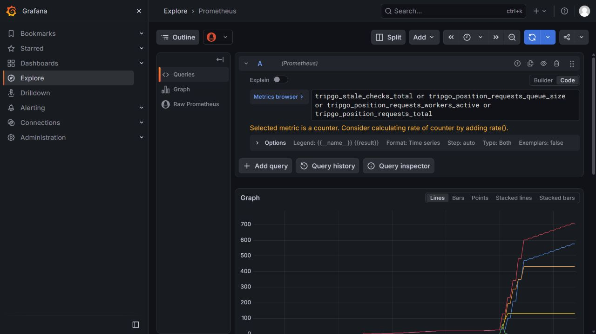

## Что сделано

- добавлена миграция `last_position_at`, `trip_positions` и частичного индекса для сканера;
- добавлены `POST` и `GET /api/v1/trips/{tripId}/positions`;
- сохранение координаты и обновление поездки выполняются через `TxManager`;
- `GREATEST` в SQL не позволяет опоздавшей координате уменьшить `last_position_at`;
- добавлен один сканер с подменяемым тикером, ограниченная FIFO-очередь и фиксированный worker pool;
- реализованы дедупликация, отмена задачи координатой и неблокирующий `dropped` при заполнении очереди;
- добавлен HTTP-гейтвей Push Service без ретраев, с отдельным клиентом и таймаутом;
- добавлены метрики пула, span link и тесты с `-race` и `goleak`.

## Схема

```text
тикер → сканер PostgreSQL → ограниченная очередь → worker pool → Push Service
                                  ↑
                          отмена при координате
```

## Проверки

- `golangci-lint run ./...` — `0 issues`;
- `go test -race -count=2 ./...` — успешно;
- интеграционные тесты репозитория с `-race` — успешно;
- миграции применяются до версии 3;
- маршрут сортируется по `recorded_at`, затем по `id`;
- Push Service получает `REQUEST_POSITION` каждые `POSITION_CHECK_INTERVAL`;
- при задержке Push Service очередь заполняется, растёт `dropped`, HTTP API продолжает отвечать.

## Метрики worker pool под нагрузкой



Во время проверки использовались 200 устаревших активных поездок, очередь размером 100 и задержка Push Service 5 секунд. После проверки задержка сброшена до нуля.

## EXPLAIN ANALYZE

План получен на таблице с 5202 поездками. Последовательного просмотра таблицы нет, используется `trips_active_position_poll_idx`:

```text
Sort  (actual time=0.524..0.528 rows=12 loops=1)
  Sort Key: (COALESCE(last_position_at, started_at)), id
  ->  Bitmap Heap Scan on trips  (actual time=0.120..0.253 rows=12 loops=1)
        Recheck Cond: ((COALESCE(last_position_at, started_at) < (now() - '00:01:00'::interval)) AND (status = 'active'::text))
        ->  Bitmap Index Scan on trips_active_position_poll_idx  (actual time=0.086..0.087 rows=12 loops=1)
              Index Cond: (COALESCE(last_position_at, started_at) < (now() - '00:01:00'::interval))
Planning Time: 5.093 ms
Execution Time: 0.773 ms
```

Полный вывод сохранён в `docs/explain-analyze.txt`.
