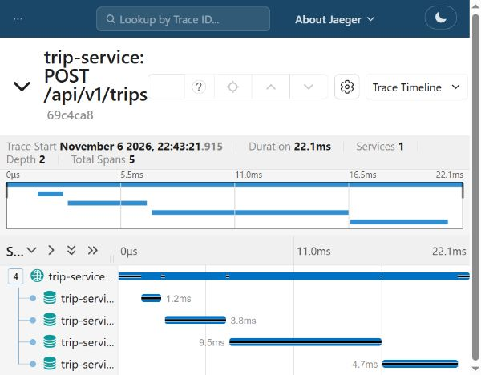
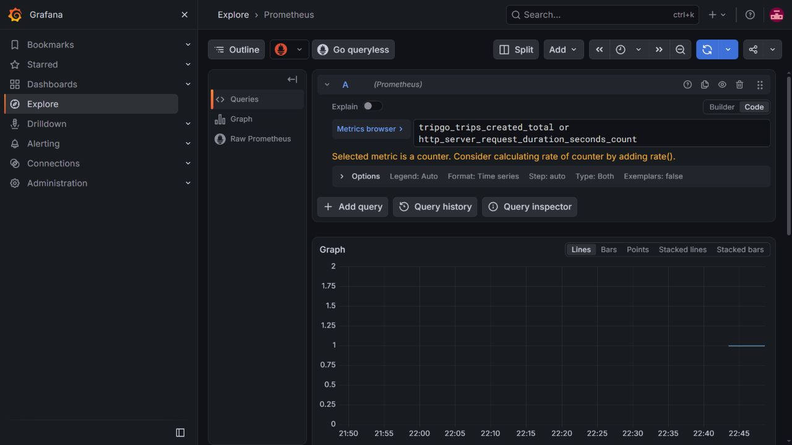

## Что сделано

- сервис разделён на domain, use case, HTTP transport, repository и infra;
- интерфейсы объявлены на стороне потребителей и собираются в container;
- доменные ошибки переводятся в RFC 9457 Problem в одном месте;
- добавлены unit-, handler- и integration-тесты;
- добавлены golangci-lint, gomock и покрытие;
- подключены JSON-логи, OpenTelemetry-трейсы и метрики;
- PostgreSQL инструментирован на уровне пула;
- сохранён прежний OpenAPI-контракт и существующие миграции.

## Схема слоёв

```text
HTTP ──► use case ──► domain
                 ▲
repository ──────┘
infra ──► repository, container
container ──► конкретные реализации
```

Интерфейсы находятся в `contract.go` пакета-потребителя. Use case определяет минимальные методы хранилища и транзакций, а HTTP-обработчик определяет минимальный интерфейс use case. Благодаря этому домен и сценарии не зависят от PostgreSQL и HTTP.

## Принятые решения

- переход `active → completed` выполняет доменная модель;
- создание поездки и запись истории статуса выполняются в одной транзакции;
- конкурентное завершение защищено условием `status = active` в UPDATE;
- уникальный partial index преобразуется в `ErrDriverBusy`;
- неизвестные ошибки не раскрывают детали клиенту;
- middleware выполняются в порядке Recover → Tracing → Logging → Metrics;
- PostgreSQL-спаны и `db.client.operation.duration` создаются обёрткой трассировщика пула;
- недоступность OTLP Collector не блокирует запуск и обработку запросов.

## Проверки

- `make lint` — 0 issues;
- `make test` — успешно с `-race`, домен и use case покрыты на 80–89%;
- `make test-integration` — успешно с `-race`, включая полный rollback двух INSERT;
- создание поездки — 201;
- `trace_id` совпадает в бизнес-логе, access-log и Jaeger;
- в Jaeger видны HTTP-спан и дочерние `BEGIN`, `INSERT`, `INSERT`, `COMMIT`;
- в Grafana видны HTTP-метрика и счётчик созданных поездок.

## Скриншоты

### Jaeger



### Grafana


